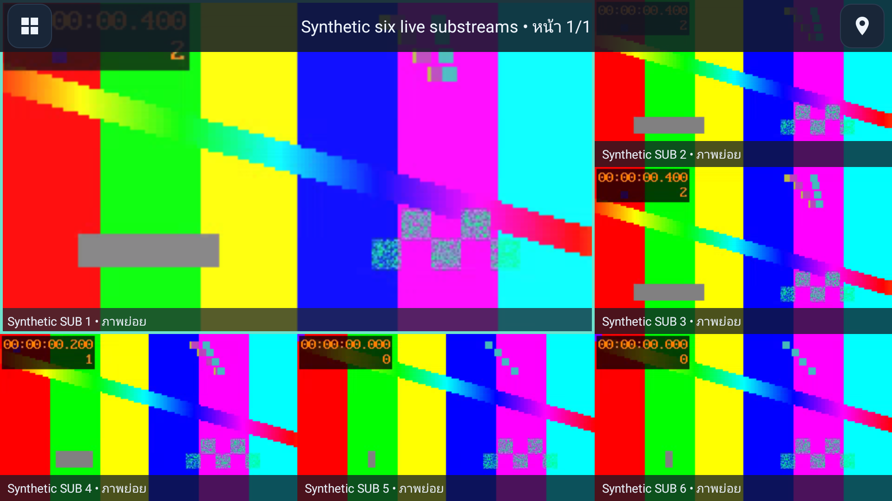

# CCTV

[](https://github.com/pnntrn/cctv-tv/actions/workflows/android.yml)
[](https://github.com/pnntrn/cctv-tv/releases)
[](https://github.com/pnntrn/cctv-tv/releases)

แอปดูกล้อง RTSP สำหรับ Android TV / Google TV ควบคุมด้วยรีโมต เชื่อมต่อกล้องโดยตรง ไม่ต้องมีบัญชีคลาวด์ รองรับ Android 8.0 ขึ้นไป

[การใช้งานภาษาไทย](#วิธีใช้งาน) · [Contributing](CONTRIBUTING.md) · [Release guide](docs/RELEASING.md) · [Security](SECURITY.md) · [Changelog](CHANGELOG.md)

A native Android TV / Google TV RTSP viewer for Android8.0+, with direct NVR connections and no cloud account. Development0.5.1 uses **substreams in every view**, including fullscreen and technician previews. The unused libVLC runtime has been removed.

This branch implements [the substream TV workflow](docs/superpowers/specs/2026-10-25-substream-tv-workflow-design.md) ([Issue#4](https://github.com/pnntrn/cctv-tv/issues/4)). It is not a published release. The public0.4.5 APK below has the older controls; see its tagged README for its behavior. Build/safety guidance: [AGENTS.md](AGENTS.md), [.env.example](.env.example).

## Download

[Download the signed 0.4.5 release candidate APK](https://github.com/pnntrn/cctv-tv/releases/download/v0.4.5-rc.1/cctv-release.apk) · [Release notes and checksums](https://github.com/pnntrn/cctv-tv/releases)

Download `cctv-release.apk` on your Android TV or transfer it to the TV, then open it to install. Install retained-key updates over the existing app without uninstalling or clearing data. Saved profiles use the same encrypted format; retention on the owner’s device must still be verified. Android 8.0 or later is required.

Version 0.4.5 corrects HEVC keyframe flags for recorder streams whose continuation-fragment headers differ from the first fragment. It also preserves key status across a picture and clears it between pictures. Version 0.4.4 detects H.264/H.265 automatically and gives technicians separate substream/mainstream picture tests with independent codec/results. Hikvision, VIGI NVR and VIGI camera paths share the same decoder; unused audio/application SDP no longer blocks valid video. H.265+ is reported as HEVC and still requires testing on the actual camera/TV. Version 0.4.3 added bounded HEVC in-band parameter discovery and simpler Mi Box setup: hold OK for one second, choose **ตั้งค่า**, then confirm. Version 0.4.1 corrects remembered-camera and grid-page restoration after reordering. It remains a release candidate for physical-device verification. Version 0.4.0 introduced Thai controls, an edge-to-edge camera grid with controls hidden when idle, and separate technician setup. It also includes H.264 streams with missing SDP codec metadata and recorder draft recovery. Actual Hikvision playback and update/profile preservation on the owner's Mi Box still need device verification.

[Source and updated usage documentation for this candidate](https://github.com/pnntrn/cctv-tv/tree/v0.4.5-rc.1#readme) · [Review PR #1](https://github.com/pnntrn/cctv-tv/pull/1) (unmerged).

## Viewing in development0.5.1

- Substream only: grid, fullscreen and setup never request the saved mainstream URL. Recorder encoding/recording quality is unchanged.
- Borderless layouts1/4/6/8/9/16. Six has one large2x2 cell and five small cells; video retains its aspect ratio. Fewer simultaneous cameras may be necessary on limited TV hardware.
- D-pad selects a camera; OK opens fullscreen. One short Back restores the location's configured default grid and keeps the selected visible camera/page when possible. A second distinct short Back within700ms opens Android TV Home. Held/repeated Back is ignored; other input, location changes and lifecycle changes reset the sequence. Dialogs and unsaved edits retain their cancel/confirmation guards.
- Remote/pointer activity reveals the top bar; it hides after1500ms idle, returning toolbar focus to the camera or empty-content target first. Open dialogs/settings keep their navigation. Up from the first camera row reaches the bar; Down returns to cameras.
- The top-right cluster has four48dp actions: layout, next location, next page and Settings. Text reads location, layout, then page. Location and next-page clicks wrap; next page exits fullscreen to the grid before advancing. Held Left/Right and long-click layout/location picker shortcuts remain available. Short Left/Right navigate cameras or toolbar actions.
- In fullscreen, short OK focuses the toolbar without switching streams; Left/Right changes camera. Hold OK1s for the viewing menu. One Settings click opens technician confirmation with Cancel focused by default; Back never opens setup.
- Hidden channels stay saved but do not play or appear in normal viewing. Offline channels are not automatically hidden.

### วิธีใช้งาน

แอปใช้ภาพรองทุกมุมมอง กดลูกศรเพื่อเลือกกล้อง แล้วกด **OK** เพื่อดูเต็มจอ กด **ย้อนกลับ** หนึ่งครั้งเพื่อคืนตารางเริ่มต้นของสถานที่ กดสั้นอีกครั้งภายใน700มิลลิวินาทีเพื่อไปหน้าแรก Android TV เมนูและกรอบเลือกจะซ่อนเมื่อไม่กดรีโมต1.5วินาที

แถบบนแสดงชื่อสถานที่ รูปแบบตาราง และเลขหน้า ตามด้วยไอคอนด้านขวา: เปลี่ยนตาราง เปลี่ยนสถานที่ หน้าถัดไป และตั้งค่า กดไอคอนสถานที่เพื่อวนไปสถานที่ถัดไป กดตั้งค่าหนึ่งครั้งแล้วเลือกยืนยัน โดยค่าเริ่มต้นอยู่ที่ยกเลิก กดซ้ายค้างเพื่อเลือกรูปแบบตาราง หรือขวาค้างเพื่อเลือกสถานที่ มีตาราง6กล้องแบบภาพใหญ่1ภาพเล็ก5

## Camera names and frame health

Best-effort RTSP SDP media/session names appear only when meaningful and safe. Saved custom names always win; detected names replace only generated `Camera N` / `กล้อง N` display labels. URLs are never used to infer names. The app rejects URL/userinfo, control/bidi characters and generic names before publishing a Media3 label, and limits names to80Unicode code points. H.264/HEVC in-band discovery retains that label. Many recorders publish only generic SDP titles, so a useful camera name is not guaranteed; there is no ONVIF/API name lookup. Optional sanitized metadata is cached in the encrypted schema3 profile and invalidated when the SUB URL changes; no profile migration is required.

Every playing tile keeps a small bottom-right badge when the toolbar hides. It reads actual rendered-output counters once per second: live with measured rendered FPS, no-new-frames after3000ms without an increase, connecting before output, or error after a playback failure. A still scene stays live while new frames render. This measures delivery to the video surface, not motion or whether the recorder is re-encoding an unchanged image. FPS is sampled, not the camera's advertised rate; low-rate streams can briefly show0FPS while still inside the3s grace period. There is no invented heartbeat or bandwidth value. Polling stops on background/release and does not create additional players. Physical TV/NVR behavior still requires device verification.

## Technician setup and channels

1. Hold OK1s → **ตั้งค่า** → confirm technician entry. Add a location and its Hikvision/VIGI NVR together; one location has one NVR. Existing profiles with several NVRs are split without deleting channels or credentials. Legacy unlinked cameras remain viewable/manageable; there is no new standalone/custom-camera add flow.
2. The recorder editor includes location name and default grid, address, credentials and channel range. **Test & save** displays only the substream and detects H.264/HEVC after an actual rendered frame. Saving stays disabled until that frame.
3. **จัดเรียงและซ่อนช่องกล้อง** shows six live previews per page. Select a source camera, then a destination to swap. Use **ซ่อน/แสดงกล้องที่เลือก** or hold OK on a channel to toggle visibility. **บันทึกการจัดเรียง** saves; Cancel/Back/background restores the original order and visibility.
4. Location/NVR removal requires confirmation and removes only the app profile, not recorder data. Raw camera URLs and passwords are not shown on the viewing screen.

Nonsecret drafts include location/default-grid fields. Passwords are never stored in drafts and are cleared on background/recreation. A blank password while editing an existing NVR retains its saved credential. Settings access ends when returning to viewing or backgrounding.

| NVR | Substream channel1 | Substream channel16 |
| --- | --- | --- |
| Hikvision | `/Streaming/Channels/102` | `/Streaming/Channels/1602` |
| VIGI NVR | `/live/1/2/avm` | `/live/16/2/avm` |

Actual firmware/codec/decoder capacity must be tested on the TV; a preset is not a universal compatibility guarantee. Saved legacy MAIN URLs remain encrypted data for profile compatibility, and are never played in0.5.0.

## Set up from your phone

Technician setup → **ขั้นสูง → ตั้งค่าผ่านโทรศัพท์** opens temporary local pairing. Use the address/PIN shown on the TV on a trusted LAN. The phone can edit the location's single NVR, not create standalone cameras or a second NVR. Passwords/URLs are not returned to the phone.

The phone's RTSP test establishes protocol reachability only. Sending the tested settings opens a substream preview on the TV; **the user must see a decoded picture and confirm Save on the TV** before profiles change. The phone reports pending TV confirmation rather than falsely claiming a save.

Pairing uses an expiring single-IP session, origin/host checks, HTTP-only same-site cookies and a single-use configuration proof. Closing/backgrounding ends setup. Credentials travel over local HTTP, so use a trusted network.

## Error messages

Authentication rejection, missing stream paths, network reachability, timeouts and decoder limits get separate messages. Retryable failures back off from 2 to 30 seconds. Authentication/path/decoder failures stop retrying until playback is reopened or settings change. Raw exceptions and credential-bearing URLs are not intentionally shown or logged by this app; system/media library diagnostics should still be treated as sensitive.

## APK builds and permanent signing

[GitHub Actions](https://github.com/pnntrn/cctv-tv/actions) produces **cctv-tv-apks** with:

- Debug/test APKs are in **ui-test-apks** when the native test job is requested; release artifacts are not duplicated on PRs.
- `cctv-release.apk`: installable optimized release **when retained signing is configured**.
- `cctv-release-unsigned.apk`: build output when signing is not configured; cannot be installed directly.
- `SHA256SUMS`: hashes of the outputs.

**Automatic CI signing requires one private GitHub repository secret: `CCTV_SIGNING_BUNDLE`.** It contains JSON with `keystore` (base64 PKCS12), `password`, and `alias`. The workflow uses it only in runner temporary storage, masks the password and deletes the keystore at the end of the build job. No private key is committed or included in artifacts.

The retained key is already configured and privately backed up. Do not generate another key for an existing installation. `scripts/configure-signing.sh` is for initial project bootstrap only. For signed builds, run the workflow manually or push a reviewed tag and use its signed `cctv-release.apk`. Pull-request builds deliberately do not load the signing secret.

The first 0.2.0 release was signed separately with the retained key and its APK v2/v3 signatures verified. Its certificate SHA-256 is `4bb96b0ff9021cc49885f9cdd02d62ec3e58c3704cd65853e8dc2269316c5f9b`. It is approximately 418 KiB. The retained signing identity is now configured in GitHub Actions.

The old development build used an ephemeral debug key. Moving from that build to the retained release key may require a one-time uninstall, which removes local profiles. Subsequent releases signed with the retained key install as updates. Debug builds continue using development keys and are not the supported upgrade channel. Release version codes are set explicitly in `app/build.gradle` and must increase for each update.

## Native UI preview

Native emulator captures use synthetic camera fixtures. The six-view capture contains six actually decoded test feeds.




## Validation

- `bash scripts/check-core.sh` executes the production Java rules: original 48 checks plus recorder updates, legacy linking, pairing access and RTSP probe tests.
- GitHub Actions runs unit tests, HTTP setup protocol tests, Android lint and debug/release compilation.
- A landscape Android emulator smoke job checks navigation, fullscreen/back, settings, recorder editing, saved arrangement and reopen behavior. It publishes native screenshots under **native-ui-screenshots**. Fixture cameras use loopback URLs, with no real camera credentials or footage.
- [Verified build and emulator run](https://github.com/pnntrn/cctv-tv/actions/runs/39948381626) passed for application commit `85cbc4a9987cefd1324e5c8f1cc38a85da0faa2e`.
- `bash scripts/check-digest.sh` additionally checks MD5 Digest authentication with and without qop, including reserved credential/path characters.
- A physical TV stick and reachable NVR are still needed to verify real-camera compatibility, Wi-Fi behavior and decoder capacity.
- [0.4.0 validation](docs/validation-0.4.0.md) records the 24 unit methods, ten native methods, lint/build results and the remaining physical-device checks.

- [0.4.1 validation](docs/validation-0.4.1.md) records 28 unit methods, 12 native methods and release-verifier checks.

- [0.4.4 codec-check validation](docs/validation-0.4.4.md) records independent stream checks and the synthetic Hikvision/VIGI path/codec matrix.
- [0.4.3 setup/HEVC validation](docs/validation-0.4.3.md) records the simpler setup flow, H.265 regression and profile-persistence checks.
- [0.4.2 Mi Box validation](docs/validation-0.4.2.md) records 34 unit methods and 14 native methods, including controls without a Menu button.

Toolchain: JDK 17, pinned Gradle wrapper 8.11.1, AGP 8.9.2, SDK 35, Media3 1.8.0. Use `./gradlew testDebugUnitTest lintDebug assembleDebug assembleRelease` (`.\gradlew.bat` on Windows). See [CONTRIBUTING.md](CONTRIBUTING.md) for all checks. Historical validation records each named version; it does not establish physical-device compatibility for 0.4.2.

Settings are encrypted locally using Android Keystore AES-GCM and saved atomically. Backups are disabled. Uninstalling / clearing app data deletes profiles. RTSP itself is normally unencrypted: use a trusted LAN/VPN. This is an Android app, not a Samsung Tizen app.

## Branding

The CCTV camera-grid mark, CCTV wordmark, TV banner and adaptive launcher icon are native vector assets. Editable artwork is in `brand/cctv-logo.svg`, with a PNG preview alongside it.

## In-app updates (0.3)

Enter technician setup and choose **ตรวจสอบอัปเดต**. The app checks the public APK-only feed in [pnntrn/cctv-updates](https://github.com/pnntrn/cctv-updates). This legacy feed remains separate from the release candidate download above. Download, then select Install; Android may first ask you to allow installations from CCTV. Press Back after enabling it, then select Install again. Installation needs Android confirmation.

Updates keep encrypted profiles when the existing installation uses the retained release key. Old debug builds require a one-time switch to the signed release. The updater rejects a different package, signing key, older/equal version, incompatible Android version, incorrect size or SHA-256. Every request and redirect uses HTTPS. Downloads run only while CCTV is visible and stop on Back/cancel/background; no scheduled checks, storage permission, or account tokens.

Release signing is configured with the private `CCTV_SIGNING_BUNDLE` Actions secret. CI builds the signed `cctv-release.apk`; only publish after build, lint, unit tests and native UI checks pass. With authenticated GitHub CLI and Android SDK `aapt`/`apksigner` on PATH, run:

```sh
python3 scripts/publish-update.py path/to/cctv-release.apk --notes "Changes in this release"
```

This verifies the retained certificate and version, then publishes the APK, public release notes and feed to the legacy updater repository. Downloads are pinned to an immutable APK commit. Source is public in this repository; signing files remain private. Publishing to the legacy feed needs write access to `pnntrn/cctv-updates`; it does not require embedding a GitHub token in the app or setting up a cross-repository CI token. Direct APK downloads are also available from this repository's Releases page above.


## License and notices

The original CCTV project code currently has no project license; public source availability does not grant a general license to reuse or redistribute it. The owner is choosing the project license. Vendored Media3 code retains its Apache-2.0 license and upstream notices. See [third-party notices](THIRD_PARTY_NOTICES.md).


## License

Original CCTV code is licensed under [GPLv3 or later](LICENSE), as approved by the owner. Vendored Media3 remains under its Apache2.0 notices. LibVLC was a historical private experiment and is not bundled in0.5.0. See [THIRD_PARTY_NOTICES.md](THIRD_PARTY_NOTICES.md). Public release/tag/feed publication still requires explicit approval.
