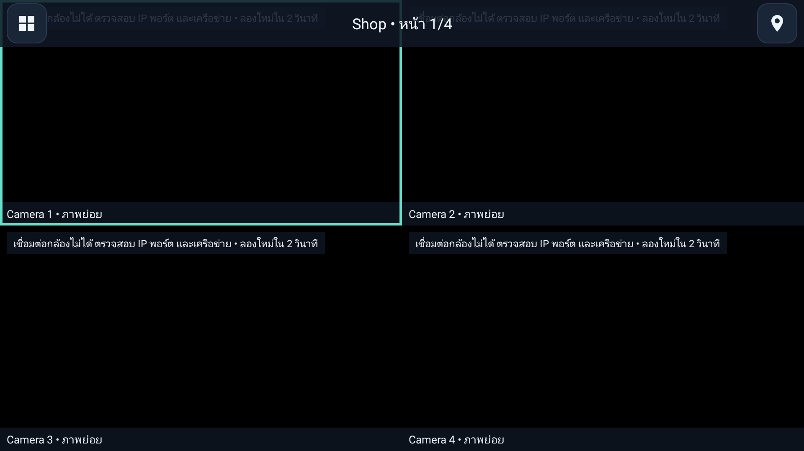
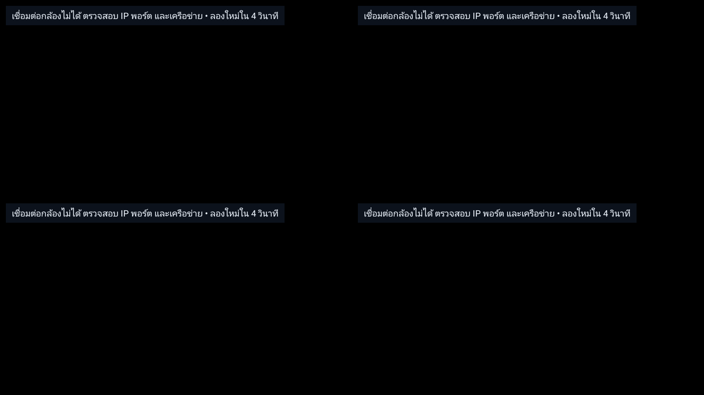
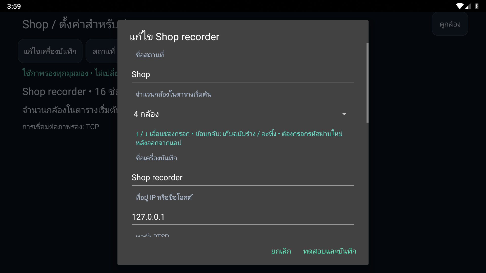

# CCTV

[](https://github.com/pnntrn/cctv-tv/actions/workflows/android.yml)
[](https://github.com/pnntrn/cctv-tv/releases)
[](https://github.com/pnntrn/cctv-tv/releases)

แอปดูกล้อง RTSP สำหรับ Android TV / Google TV ควบคุมด้วยรีโมต เชื่อมต่อกล้องโดยตรง ไม่ต้องมีบัญชีคลาวด์ รองรับ Android 8.0 ขึ้นไป

[การใช้งานภาษาไทย](#วิธีใช้งาน) · [Contributing](CONTRIBUTING.md) · [Release guide](docs/RELEASING.md) · [Security](SECURITY.md) · [Changelog](CHANGELOG.md)

A lightweight native Android TV / Google TV RTSP viewer for Android 8.0+. Direct connections to Hikvision, VIGI and custom RTSP cameras. No cloud account, streaming server, WebView, analytics, or bundled FFmpeg.

## Download

[Download the signed 0.4.3 release candidate APK](https://github.com/pnntrn/cctv-tv/releases/download/v0.4.3-rc.1/cctv-release.apk) · [Release notes and checksums](https://github.com/pnntrn/cctv-tv/releases)

Download `cctv-release.apk` on your Android TV or transfer it to the TV, then open it to install. Install retained-key updates over the existing app without uninstalling or clearing data. Saved profiles use the same encrypted format; retention on the owner’s device must still be verified. Android 8.0 or later is required.

Version 0.4.3 simplifies Mi Box setup: hold OK for one second, choose **ตั้งค่า** (Settings), then confirm. Back closes normally. It also supports H.265/HEVC streams whose SDP omits codec parameter sets by reading real in-band VPS/SPS/PPS; H.264 support remains. Version 0.4.1 corrects remembered-camera and grid-page restoration after reordering. It remains a release candidate for physical-device verification. Version 0.4.0 introduced Thai controls, an edge-to-edge camera grid with controls hidden when idle, and separate technician setup. It also includes H.264 streams with missing SDP codec metadata and recorder draft recovery. Actual Hikvision playback and update/profile preservation on the owner's Mi Box still need device verification.

[Source and updated usage documentation for this candidate](https://github.com/pnntrn/cctv-tv/tree/v0.4.3-rc.1#readme) · [Review PR #1](https://github.com/pnntrn/cctv-tv/pull/1) (unmerged).

## Viewing

- The app opens the last location's edge-to-edge camera grid. After four seconds without remote input, controls, camera labels and selection borders hide. Playback errors remain visible.
- Multiple locations; 1, 4, 9 or 16 live substreams per page; up to 256 saved cameras per location. Use the D-pad at left/right grid edges to reach the previous/next page.
- D-pad highlights a tile. **OK** opens the mainstream. **Back** restores the substream grid and focused camera.
- Left/right changes fullscreen camera. OK toggles main/substream. Mainstream failure automatically falls back once to the substream.
- Fullscreen labels hide after four seconds; remote input reveals them again. Playback errors remain visible.
- The last location, camera and grid page are remembered after a normal close / reopen.
- Hold **OK for one second** to open viewing options for the grid, grid size and existing locations. A short OK still opens the selected camera or toggles its fullscreen stream. Holding OK never opens editing controls. Remotes with a Menu button can still short-press it for viewing options.
- Inside the viewing menu, choose **ตั้งค่า** (Settings), then confirm **เข้าสู่การตั้งค่า**, to enter technician setup. Remotes with Menu may also hold Menu for three seconds from viewing. Reorder cameras there with the up/down actions or a numbered move. Returning to viewing or backgrounding ends technician access.
- Only the current page plays. Fullscreen releases all grid decoders. Settings, arrangement and backgrounding release playback. Audio is disabled in this version.
- Controls use Thai labels, visible remote focus and 48dp targets. The idle viewing grid has no decorative gaps or borders. Video keeps its original aspect ratio.

### วิธีใช้งาน

เปิดแอปเพื่อดูตารางกล้องเต็มจอ กดลูกศรเพื่อเลือกกล้อง แล้วกด **OK** เพื่อดูเต็มจอ กด **ย้อนกลับ** เพื่อกลับตาราง เมนูและกรอบเลือกจะหายไปเมื่อไม่กดรีโมต 4 วินาที

กด **OK ค้าง 1 วินาที** เพื่อเปิดเมนูเปลี่ยนรูปแบบตารางหรือสถานที่ สำหรับช่าง ให้เปิดเมนูนี้แล้วเลือก **ตั้งค่า** จากนั้นเลือก **เข้าสู่การตั้งค่า** เพื่อเพิ่ม แก้ไข หรือลบข้อมูล กด OK หรือย้อนกลับสั้น ๆ เพื่อใช้งานดูกล้องตามปกติ หน้าดูกล้องปกติไม่มีปุ่มแก้ไขข้อมูล

Sixteen streams requires enough hardware decoders. Start with four tiles on smaller sticks. Suggested initial substream encoding: H.264, roughly 640×360 or 640×480, 5–10 fps and 256–512 kbps; tune the NVR itself. No measured stream-count or latency guarantee is made.

## Setup and recorder editing

1. Hold **OK for one second**, then choose **ตั้งค่า** (Settings) in the viewing menu. Confirm technician setup and create a location, such as **Shop**.
2. Choose **เพิ่มเครื่องบันทึก**. One NVR is the primary setup for each location; an existing recorder gets **แก้ไขเครื่องบันทึก** instead. Additional NVRs and standalone/custom cameras are available under **ขั้นสูง**.
3. Enter the recorder address, RTSP port, credentials and channel range.
4. **Test & save** previews the first substream on the TV. **Save channels** becomes available after a decoded video frame.
5. Use **แก้ไขเครื่องบันทึก** to edit the location's primary NVR, or **ขั้นสูง → เครื่องบันทึกทั้งหมด** for additional recorders. Existing linked camera IDs, names and order stay intact. Channels outside a changed range are removed; new channels are appended.

Recorder drafts retain non-secret form fields across backgrounding and recreation. Passwords are never stored in drafts; backgrounding clears the entered password and preview verification. Back offers Keep draft or Discard. Re-enter technician setup to resume, then test again before saving. A blank password while editing an existing recorder keeps its saved credential.

Canonical preset URLs from the original app are linked to shared recorder settings when the old profile file is loaded. Other URLs stay standalone. Editing a camera's URLs directly makes it standalone, so later recorder edits do not overwrite the custom URLs. Standalone camera forms include a test preview and an explicit show/hide URLs control.

| Device | Substream | Mainstream |
| --- | --- | --- |
| Hikvision NVR channel 1 | `/Streaming/Channels/102` | `/Streaming/Channels/101` |
| Hikvision NVR channel 16 | `/Streaming/Channels/1602` | `/Streaming/Channels/1601` |
| VIGI NVR channel 1 | `/live/1/2/avm` | `/live/1/1/avm` |
| VIGI standalone camera | `/stream2` | `/stream1` |

VIGI NVR RTSP requires compatible firmware and an enabled server. Camera paths `/stream1` and `/stream2` are not NVR channel paths. Custom URLs support firmware-specific alternatives. Credentials entered in the preset form are escaped automatically.

## Set up from your phone

1. Enter technician setup, then choose **ขั้นสูง → ตั้งค่าผ่านโทรศัพท์**.
2. On a phone on the same trusted LAN/Wi-Fi, open the address shown on the TV.
3. Enter the six-digit pairing code. One phone is allowed per session; five failed PIN attempts close access. The session expires after ten minutes, closes when the TV dialog closes, and stops when the app backgrounds.
4. Add or edit a recorder or standalone camera. Blank saved passwords/URLs keep their existing values; saved passwords and RTSP URLs are never sent back to the phone.
5. **Test connection** checks RTSP authentication and whether a video stream exists. It is a protocol check, not a decoder/picture guarantee. **Save to TV** uses a single-use proof for that exact tested configuration. A TV preview verifies decoding separately.

This is a temporary local HTTP service, not a cloud service. Use a trusted network: credentials travel over that local connection. The service uses an origin/host check, same-site HTTP-only session cookies, a bounded request size and one paired IP. It has no file browsing, cloud relay, open CORS or background setup server. Closing pairing prevents pending drafts from being saved and invalidates the session.

## Error messages

Authentication rejection, missing stream paths, network reachability, timeouts and decoder limits get separate messages. Retryable failures back off from 2 to 30 seconds. Authentication/path/decoder failures stop retrying until playback is reopened or settings change. Raw exceptions and credential-bearing URLs are not intentionally shown or logged by this app; system/media library diagnostics should still be treated as sensitive.

## APK builds and permanent signing

[GitHub Actions](https://github.com/pnntrn/cctv-tv/actions) produces **cctv-tv-apks** with:

- `cctv-tv-debug.apk`: installable development build.
- `cctv-release.apk`: installable optimized release **when retained signing is configured**.
- `cctv-release-unsigned.apk`: build output when signing is not configured; cannot be installed directly.
- `SHA256SUMS`: hashes of the outputs.

**Automatic CI signing requires one private GitHub repository secret: `CCTV_SIGNING_BUNDLE`.** It contains JSON with `keystore` (base64 PKCS12), `password`, and `alias`. The workflow uses it only in runner temporary storage, masks the password and deletes the keystore at the end of the build job. No private key is committed or included in artifacts.

The retained key is already configured and privately backed up. Do not generate another key for an existing installation. `scripts/configure-signing.sh` is for initial project bootstrap only. For signed builds, run the workflow manually or push a reviewed tag and use its signed `cctv-release.apk`. Pull-request builds deliberately do not load the signing secret.

The first 0.2.0 release was signed separately with the retained key and its APK v2/v3 signatures verified. Its certificate SHA-256 is `4bb96b0ff9021cc49885f9cdd02d62ec3e58c3704cd65853e8dc2269316c5f9b`. It is approximately 418 KiB. The retained signing identity is now configured in GitHub Actions.

The old development build used an ephemeral debug key. Moving from that build to the retained release key may require a one-time uninstall, which removes local profiles. Subsequent releases signed with the retained key install as updates. Debug builds continue using development keys and are not the supported upgrade channel. Release version codes are set explicitly in `app/build.gradle` and must increase for each update.

## Native UI preview

These are native emulator screenshots using deliberately offline fixture cameras, not real CCTV footage.







## Validation

- `bash scripts/check-core.sh` executes the production Java rules: original 48 checks plus recorder updates, legacy linking, pairing access and RTSP probe tests.
- GitHub Actions runs unit tests, HTTP setup protocol tests, Android lint and debug/release compilation.
- A landscape Android emulator smoke job checks navigation, fullscreen/back, settings, recorder editing, saved arrangement and reopen behavior. It publishes native screenshots under **native-ui-screenshots**. Fixture cameras use loopback URLs, with no real camera credentials or footage.
- [Verified build and emulator run](https://github.com/pnntrn/cctv-tv/actions/runs/39948381626) passed for application commit `85cbc4a9987cefd1324e5c8f1cc38a85da0faa2e`.
- `bash scripts/check-digest.sh` additionally checks MD5 Digest authentication with and without qop, including reserved credential/path characters.
- A physical TV stick and reachable NVR are still needed to verify real-camera compatibility, Wi-Fi behavior and decoder capacity.
- [0.4.0 validation](docs/validation-0.4.0.md) records the 24 unit methods, ten native methods, lint/build results and the remaining physical-device checks.

- [0.4.1 validation](docs/validation-0.4.1.md) records 28 unit methods, 12 native methods and release-verifier checks.

- [0.4.3 setup/HEVC validation](docs/validation-0.4.3.md) records the simpler setup flow, H.265 regression and profile-persistence checks.
- [0.4.2 Mi Box validation](docs/validation-0.4.2.md) records 34 unit methods and 14 native methods, including controls without a Menu button.

Toolchain: JDK 17, pinned Gradle wrapper 8.11.1, AGP 8.9.2, SDK 35, Media3 1.8.0. Use `./gradlew testDebugUnitTest lintDebug assembleDebug assembleRelease` (`.\gradlew.bat` on Windows). See [CONTRIBUTING.md](CONTRIBUTING.md) for all checks. Historical validation records each named version; it does not establish physical-device compatibility for 0.4.2.

Settings are encrypted locally using Android Keystore AES-GCM and saved atomically. Backups are disabled. Uninstalling / clearing app data deletes profiles. RTSP itself is normally unencrypted: use a trusted LAN/VPN. This is an Android app, not a Samsung Tizen app.

## Branding

The CCTV camera-grid mark, CCTV wordmark, TV banner and adaptive launcher icon are native vector assets. Editable artwork is in `brand/cctv-logo.svg`, with a PNG preview alongside it.

## In-app updates (0.3)

Enter technician setup and choose **ตรวจสอบอัปเดต**. The app checks the public APK-only feed in [pnntrn/cctv-updates](https://github.com/pnntrn/cctv-updates). This legacy feed remains separate from the release candidate download above. Download, then select Install; Android may first ask you to allow installations from CCTV. Press Back after enabling it, then select Install again. Installation needs Android confirmation.

Updates keep encrypted profiles when the existing installation uses the retained release key. Old debug builds require a one-time switch to the signed release. The updater rejects a different package, signing key, older/equal version, incompatible Android version, incorrect size or SHA-256. Every request and redirect uses HTTPS. Downloads run only while CCTV is visible and stop on Back/cancel/background; no scheduled checks, storage permission, or account tokens.

Release signing is configured with the private `CCTV_SIGNING_BUNDLE` Actions secret. CI builds the signed `cctv-release.apk`; only publish after build, lint, unit tests and native UI checks pass. With authenticated GitHub CLI and Android SDK `aapt`/`apksigner` on PATH, run:

```sh
python3 scripts/publish-update.py path/to/cctv-release.apk --notes "Changes in this release"
```

This verifies the retained certificate and version, then publishes the APK, public release notes and feed to the legacy updater repository. Downloads are pinned to an immutable APK commit. Source is public in this repository; signing files remain private. Publishing to the legacy feed needs write access to `pnntrn/cctv-updates`; it does not require embedding a GitHub token in the app or setting up a cross-repository CI token. Direct APK downloads are also available from this repository's Releases page above.


## License and notices

The original CCTV project code currently has no project license; public source availability does not grant a general license to reuse or redistribute it. The owner is choosing the project license. Vendored Media3 code retains its Apache-2.0 license and upstream notices. See [third-party notices](THIRD_PARTY_NOTICES.md).
